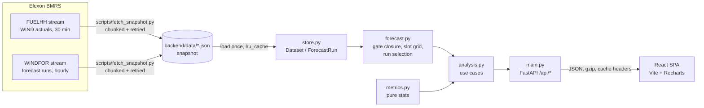

# Architecture & design notes

A guide for a technical reviewer: how the system is put together, why, and where to look.

## 1. Overview

| Layer | File | Responsibility | Depends on |
|---|---|---|---|
| Ingestion | `backend/app/elexon.py`, `scripts/fetch_snapshot.py` | Download FUELHH (WIND) and WINDFOR in 7-day chunks with retries; dedupe chunk edges | httpx |
| Data | `backend/app/store.py` | Parse the snapshot into typed, sorted, immutable structures; `ForecastRun.value_at` interpolation; `latest_run_before` (bisect) | – |
| Domain | `backend/app/forecast.py` | UK-local gate closure → UTC, delivery-day half-hour grid (46/48/50 periods across DST), day-ahead selection, error pairs, lead-time pairs | store |
| Statistics | `backend/app/metrics.py` | Pure functions: quantile, summarize, histogram, group_by | – |
| Use cases | `backend/app/analysis.py` | Compose the views the UI needs; no-look-ahead quantiles; calibration; bias adjustment | forecast, metrics |
| HTTP | `backend/app/main.py` | Routing, query validation (422s), gzip, CDN cache headers, OpenAPI | analysis |
| UI | `frontend/src` | Pages, charts, shared market settings | REST API |

The dependency direction is strictly inward. `metrics` and `forecast` know nothing about HTTP, so they are unit-tested with synthetic data.

## 2. Key domain decisions

**What the decision looks like.** The desk buys on D−1 for delivery day D. The GB day-ahead auctions close before the European SDAC auction: EPEX at 09:20 UK, N2EX at 09:50 UK. The default deadline is 09:20 because it is the earliest, so a forecast available then is usable on both exchanges. The UI lets the user switch deadlines or enter their own.

**Forecast selection** (`Dataset.latest_run_before`). The selected run is the newest `publishTime ≤ deadline`. WINDFOR publishes about 8 times a day (02:30, 04:30, 07:30, 09:30, 11:30, 15:30, 18:30, 22:30 UTC). At 09:20 that is the 07:30 run, which reaches 16.5–40 h ahead. At 09:50 it is the 09:30 run. This rule is the core of the product and is pinned by tests (`test_latest_run_before_gate_is_selected`, `test_run_published_exactly_at_gate_counts`, `test_day_ahead_uses_latest_run_before_gate`).

**Resolution mismatch.** Forecasts are hourly and actuals are half-hourly. Forecasts are linearly interpolated onto the settlement-period grid, so all 48 periods are scored. The horizon analysis uses the raw hourly points, with no interpolation, matched to the period starting at the same time.

**Time zones.** All storage is in UTC. "UK day" and "deadline" are computed with `zoneinfo('Europe/London')`. January is GMT, but the code and tests handle BST and 46/50-period clock-change days, so the tool generalises beyond this month.

**Quantifying risk without cheating.** For each decision, the error sample is the signed day-ahead errors of the previous N days (default 30), using only half-hours that had already happened before that day's deadline. Three quantiles of that sample give:
- the band, P(1−c) to Pc;
- **expected**, the median, which acts as a bias correction;
- **firm wind**, the lower quantile.

The accuracy page then checks calibration out of sample: across January the 90% firm level was breached 10.1% of the time. A 14-day window under-covers, with 13.4% breaches. That evidence is why the default window is 30 days.

**Why December data is included.** Early-January decisions need a trailing error history. The snapshot starts on 25 Nov 2025, but only data relevant to January decisions is used.

## 3. API design

- Read-only `GET` endpoints shaped per screen, so each page needs 1–2 requests and does no client-side analysis.
- Strict validation with FastAPI/Pydantic: the date must fall in the decision window, deadline format `HH:MM`, confidence 0.5–0.99, lookback 3–60 days. Invalid input returns 422.
- Responses are gzip-compressed. Data is immutable, so `Cache-Control: s-maxage=86400` lets Vercel's CDN serve repeated queries.
- `all_day_ahead_errors(gate_time)` is `lru_cache`d per deadline. A full-month backtest costs about 50 ms cold and is near-instant after that.

## 4. Frontend

- React 19 + TypeScript + Vite, Tailwind v4 and Recharts.
- `useApi` aborts stale requests and keeps the previous data while reloading, so charts dim instead of flashing.
- `SettingsProvider` holds the market assumptions (deadline, confidence, calibration window). They are shared across pages, so both views always agree.
- Charts use a colour-blind-validated categorical order: forecast is blue, actual is orange, bias-adjusted is aqua. The uncertainty band uses one sequential hue. Colours are set as CSS tokens with light and dark variants, so dark mode is designed rather than inverted.
- Every chart has a hover tooltip. Units sit in subtitles to avoid axis clutter. The daily table offers the same data as a table view.
- The layout is responsive and checked at 375 px.

## 5. Quality & development practices

- **Tests:** 35 backend tests (pytest) and 9 frontend tests (Vitest + Testing Library).
  - Selection logic is tested with a synthetic dataset.
  - Metrics are checked against hand-computed values.
  - The Elexon client is tested with `httpx.MockTransport`, covering filtering, chunk-edge dedupe and retries.
  - API tests run against the real snapshot.
- **Static checks:** ruff (lint + format, including bugbear and pyupgrade), TypeScript strict build, oxlint.
- **CI:** GitHub Actions runs backend lint and tests, then frontend lint, tests and build, then `docker compose build`.
- **Reproducibility:** pinned Python deps and an npm lockfile. The snapshot is committed, and `fetch_snapshot.py` regenerates it.
- **Containers:** the backend image is `python:3.12-slim` and runs as a non-root user with a healthcheck. The frontend uses a multi-stage node → nginx build, with nginx proxying `/api` and handling the SPA fallback.

## 6. Trade-offs & what I'd do next

| Choice | Why | Revisit when |
|---|---|---|
| Committed JSON snapshot instead of a DB or live calls | January 2026 is fixed history. The app is fast, deterministic and survives Elexon outages. 1.5 MB fits easily in a serverless bundle. | Moving to live operation: add scheduled ingestion into Postgres/Timescale |
| No pandas/numpy | About 3k rows. Pure Python keeps the serverless cold start and bundle small. | Data volume grows by more than 100× |
| Pooled error quantiles | Simple, transparent and calibrated in backtest | Condition on forecast level (errors are heteroscedastic), hour or lead time; or quantile regression |
| Flat demand input | The scope excludes non-wind data | Integrate a demand forecast (e.g. NDF) and price data, then optimise bids |

Natural next steps:
- Conditional or probabilistic error models.
- Curtailment-aware actuals (BOAL/constraint data) to separate forecast error from curtailment.
- Alerts when a new run moves the position.
- User auth and saved decisions.
